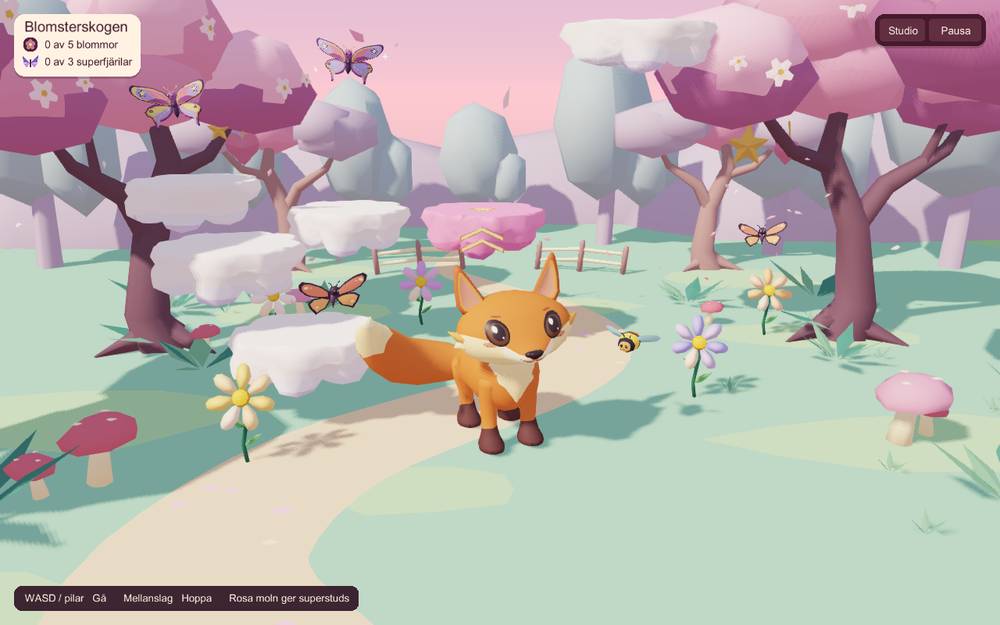

# Storm ⚡

En spelmotor skriven i [Dunder](https://github.com/Mik-pe/dunder). Storm finns
för att driva språket framåt: varje del av motorn är ett riktigt program som
kompileras av Dunders egen kompilator, och varje språkproblem vi stöter på
bokförs i [docs/dogfood.md](docs/dogfood.md).

Samma editor och samma spelloop körs på två grafikbackends: **Vulkan på
Linux** (i ett SDL-fönster) och **Metal på macOS** (i ett AppKit-fönster, som
Storm når genom Objective-C:s runtime, utan ett bibliotek att installera).
Applikationen talar bara med gränssnittet `storm-gfx`, som inte nämner någon
av dem; `src/main.ddr` väljer backend för både fönstret och agentens bildexport.

**Blomsterskogen** är Storms basspel. Hjälp räven Vallmo att plocka fem blommor till en bukett i körsbärsgläntan. Ovanför stigen finns sex moln och tre frivilliga bonusfjärilar. Det rosa studsmolnet lyfter Vallmo ända upp till Kronbalkongen. [Se molnhoppet i spelet](docs/molnhopp.mp4)



Öppna **Studio** i spelet för att arbeta med scenträdet, positioner och material. Materialstudien har en mässingsring, en keramikvas och en porslinskula på ett roterande podium. [Studion på macOS](docs/materialstudie-macos.jpg) · [Studion på Linux](docs/materialstudie-linux.jpg)

## Förutsättningar

- `dunder` 0.11.3 eller senare. Version 0.11.3 stöder den paketrelativa Metal-shadern och de lånade ECS-frågorna som används i spelet.
- Git i `PATH` och nätåtkomst vid första bygget. Dunder hämtar de låsta revisionerna av `dunder-skrift` och dess zlib-beroende automatiskt.
- **Linux:** `vulkan-icd-loader` + en ICD (`vulkan-intel`, `vulkan-radeon`, …)
  och `sdl2` för fönstret. `glslangValidator` behövs bara när GLSL-shaders
  ändras.
- **macOS:** inget att installera. Metal och AppKit finns i systemet, och
  Storm når dem genom `libobjc` och ramverken själva. Shaders kompileras av
  systemet när fönstret öppnas, så inte ens en shaderkompilerare behövs: den
  offline (`xcrun metal`) är en nedladdning på flera gigabyte som inte följer
  med Xcode, och Storm klarar sig utan den.
- Editorn använder Arial på macOS och söker efter DejaVu Sans och Liberation Sans på Linux. `--font sökväg` väljer ett eget typsnitt.

```sh
dunder run                      # spela Blomsterskogen
dunder run -- --studio          # öppna materialstudien
dunder run -- --frames 120      # rita 120 bildrutor och avsluta
dunder run -- --capture a.ppm   # en bildruta utan tangentbord
dunder run --example scene      # ECS + glTF + textlayout, utan fönster
dunder test                     # rotpaketets tester
```

## Spela och bygg med en agent

Styr Vallmo med **WASD** eller **piltangenterna**. Gå intill blommorna för att plocka dem. Den femte fullbordar buketten och vinner spelet. Du kan fortsätta upp bland molnen efteråt. Tryck **mellanslag** för att hoppa och håll en riktning även i luften. Landa på det rosa molnet och styr åt höger i studsen för att nå den översta fjärilen. **Q** pausar och **R** börjar om. I pausläget flyttar **Ett steg** fram simuleringen en tick.

```sh
dunder build -o build/storm
./build/storm --play
./build/storm --scene bana.storm.json --watch
```

Repots [MCP-konfiguration](.mcp.json) startar `./build/storm --mcp` från reporoten. En agent kan bygga en bana, provspela bestämda indata och få både positioner och en PNG från GPU:n. Med `--watch` syns nästa sparade banändring i samma fönster. [Scenformat och en provkörning från start till mål](docs/spel.md)

### Redigera modellerna i Blender

Räven, gläntan och smådjuren har redigerbara Blender-original. [Räven](assets/blomsterskogen/fox.blend) · [Gläntan](assets/blomsterskogen/glade.blend) · [Blomman och insekterna](assets/blomsterskogen/creatures.blend)

Molnbanan har en egen Blenderfil med separata scener för det vita molnet, det rosa studsmolnet och bonusfjärilen. De exporteras till `cloud.glb`, `boost_cloud.glb` och `super_butterfly.glb`. [Molnbanans Blender-original](assets/blomsterskogen/canopy.blend)

Vallmos rigg i `fox.blend` har elva poserbara leder. Ögon och öron följer huvudet. Rävens andetag, blinkning, steg, avstamp och landning har egna klipp. I `clips()` kan du ändra nyckelposer och tajming. Löpcykeln följer sträckan som Vallmo faktiskt färdas, och hur hårt hon landar avgör hur mycket kroppen trycks ihop. [Rörelserna i spelet](docs/vallmo.png) · [Vallmos animationsklipp](src/fox_animation.ddr)

I `creatures.blend` finns en separat scen för varje figur. Redigera geometri och Principled BSDF-material i Blender, välj figurens scen och exportera som **glTF Binary (.glb)** med **Active Scene** och **+Y Up**. Behåll mesharnas prefix för rörliga delar, exempelvis `PawFL_`, `Tail_` och `WingL_`. Storm animerar dem kring modellens leder.

Granska exportens geometri och material direkt med `./build/storm --glb assets/blomsterskogen/fox.glb`. För att använda en ny export i basspelet, ersätt motsvarande GLB och bygg Storm igen. Modellerna följer med i binären och Mac-appen.

## Paket

Storms egna paket följer med i samma Git-klon och kan byggas och testas var för sig. Externa paket deklareras med en full Git-revision och ingår i `dunder.lock`.

| Paket | Ansvar | Beroenden |
| --- | --- | --- |
| [`packages/storm-core`](packages/storm-core) | `Vec2`/`Vec3`/`Vec4`, `Mat4` (kolumnmajor), `Color`, projektion, multiplikation, kubytbaser och BRDF-LUT för IBL. Ren Dunder utan OS-åtkomst. | — |
| [`packages/storm-ecs`](packages/storm-ecs) | Sparse-set ECS: `Pool<T>` med dense lagring, generationshandtag i `EntityAllocator`, swap-remove, och frågor (`join2`/`join3` med dense-index). | — |
| [`packages/storm-gfx`](packages/storm-gfx) | **Kontraktet mellan Storm och en backend:** `Frame`, `Input` med `Key`, `Sky`, `trait Backend`, och geometrihjälparna (`cube`, `plane`) som äger vertexformatet. Nämnar ingen backend. Ren Dunder. | — |
| [`packages/storm-vulkan`](packages/storm-vulkan) | Backend för Linux: Vulkan 1.0 + `VK_KHR_surface`/`VK_KHR_swapchain` via `std.dl`, SDL-fönster, swapchain, render pass, pipeline med push constants, skuggor, djupbuffert och IBL-kartor. | `core`, `gfx` |
| [`packages/storm-metal`](packages/storm-metal) | Backend för macOS: AppKit-fönster och `CAMetalLayer` genom Objective-C-runtingen, kommandobuffertar, renderpass, pipelines, skuggor, djupbuffert och IBL-kartor. | `core`, `gfx` |
| [`packages/storm-gltf`](packages/storm-gltf) | glTF 2.0: GLB-container, accessors (float/index, normaliserade heltal), mesh-utplattning, interleaving. Scenval, nodtransformer och PBR-material. | `core` |
| [`packages/storm-scene`](packages/storm-scene) | Scengraf i ECS: `LocalTransform`, `Name`, `Shape`/`Mesh`, `Material`, förälderlänkar och propagering till `WorldTransform`. Modulen `animation` samplar och blandar nyckelposer för position, rotation och skala. | `core`, `ecs` |
| [`packages/storm-render`](packages/storm-render) | Deklarativ rendergraph: `PassKind`, pass med resursläsningar/skrivningar, topologisk ordning och validering. Ren data, testbar utan GPU. | — |
| [`packages/storm-physics`](packages/storm-physics) | Gravitation, impulser, friktion och kollisioner mellan sfärer och axelriktade lådor. | `core` |
| [`packages/storm-play`](packages/storm-play) | Scenformat, fast simuleringstakt, spelarkontroll, blomplockning, studsmoln, bonusfjärilar och målsensorer. | `core`, `physics` |
| [`packages/storm-mcp`](packages/storm-mcp) | Agentverktyg över stdio som styr samma spelsession som fönstret. | `play`, `image` |
| [`packages/storm-image`](packages/storm-image) | Omvandlar renderarens bild till en PNG med systemets zlib. | — |
| [`packages/storm-input`](packages/storm-input) | En fly-kamera (WASD, Space/Ctrl, Shift, höger musknapp) styrd av en `gfx.Input`. Importerar ingen backend, så kameran är testbar utan fönster. | `core`, `gfx` |
| [`packages/storm-text`](packages/storm-text) | Glyfatlas på `dunder-skrift`: rasterisering till 8-bitars coverage, shelf-packing, textlayout till quads, och `find_font` som hittar platformens font. | `dunder-skrift` |
| [`packages/storm-ui`](packages/storm-ui) | Immediate-mode UI: canvas som emitterar vertexar i punkter, samt widgets (`button`, `slider`, `row`) med `Pointer` och hot/active-id. Testbar utan fönster. | `text` |

`src/main.ddr` väljer backend. Allt annat i `src/` (editorn, spelet, exekutorn som mappar varje
`PassKind` till backendanrop) är skrivet mot `gfx.Backend` och är samma kod
på båda backends.

## Fönstret

En bildruta spelas in med kontraktets anrop, som är samma på båda backends:

```dunder
mut window := match metal.open("Storm", 1280, 800) {   // eller vulkan.open
    .Ok(opened) => opened,
    .Err(message) => { _ := sys.eprint("storm: " + message); return 1 },
}
match window.begin() {
    .Ok => {},
    .Err(message) => { _ := sys.eprint("storm: " + message) },
}
_ := window.begin_pass()
_ := window.sky(&inv_view_projection.m, &sun, &zenith, &horizon)
_ := window.mesh(&vertices, &mvp.m, &model.m, &base_color, &params, &camera, &sky, .Opaque)
_ := window.end()
```

Varje anrop som kan misslyckas säger varför i sitt `Result`. `mesh` tar åtta
`f32` per vertex för position, normal och UV, en `Sky` (solen, himlen och
ljusmatrisen, samlade i `gfx.sky_params`) och kamerans position.

- **På Vulkan** går konstanterna med push constants: 240 byte i meshpasset
  (två matriser, material, kamera och himmelsljus), och ljusmatrisen ligger i
  en uniform buffer. Storm kontrollerar enhetens `maxPushConstantsSize` när
  den väljer GPU.
- **På Metal** är samma byte ett struct i adressrymden `constant`, som bundits
  per draw med `setVertexBytes:`/`setFragmentBytes:` (högst 4 KB), så att
  fragmentsteget läser direkt ur det i stället för genom en varying.

Storms klippyta har y **nedåt** och z i `[0, 1]`, som Vulkan. Metal har y
uppåt. Skillnaden lever på ett enda ställe, `storm-metal`'s viewport: origon
längst ner och negativ höjd, så klipp-y = −1 blir översta raden. Varje pass
använder den, och shaders är Vulkan-GLSL:n portad rad för rad.

Skuggor har ett eget pass före huvudpasset: `shadow_begin` → `shadow_mesh` per
objekt → `shadow_end`. Vulkan skriver avståndet till ljuset i en färgbild med
MAX-blending (av historiska skäl, dogfood fynd 23 och 37); Metal skriver en
riktig djupbild utan fragmentfunktion. En djupkarta är det omvända (minst vinner),
så jämförelsen och bias är inverterade där.

Miljöbelysningen byggs en gång efter `open()` med
`window.build_environment(&sky)`: en `R16G16B16A16_SFLOAT`-miljökub (Vulkan;
`RGBA16Float` på Metal), 64 × 64 per yta med sex mipnivåer, nivå 0 är himlen
från origo; en GGX-prefilter per mipnivå; en 16 × 16-irradianskub; och en
64 × 64 BRDF-LUT (`R32G32_SFLOAT`/`RG32Float`) som beräknas på CPU:n i
`storm-core`. `mesh`-shadern räknar ambientet som split-sum: `irradians · kd ·
albedo / π` plus `prefiltrad(reflection, roughness) · (F0 · skala + bias)`.
Solens direkta term och skuggorna är oförändrade. Se
[next-steps 0d](docs/next-steps.md).

`sky` ritar en fullskärmstriangel på långt plan och rekonstruerar en
världsrymdsstråle ur `inv_view_proj`, så himlen är en riktig dom, inte en
skärmgradient.

När kantutjämning eller färgeffekter används ritas scenen först till en färgtextur. Ett fullskärmspass läser texturen och jämnar ut diagonala kanter med FXAA, färgtonar bilden och ger ljusa partier en mjuk glöd enligt de valda inställningarna. Därefter ritas HUD och text i skärmens egen upplösning. Med båda inställningarna avstängda ritas scenen direkt till slutbilden. [Jämför kantutjämningen](docs/kantutjamning.png)

FXAA är på från start i både spelet och Studio. Färgtoning och glöd är på i Blomsterskogen och av i materialstudien och banor utan blomskogstemat. **E** växlar färgtoning och glöd under körning. `--no-aa` stänger av kantutjämningen vid start. `--no-post` stänger av färgtoning och glöd vid start, medan `--effects` slår på dem. Ange `--no-aa --no-post` för att jämföra med direktrendering.

```dunder
mut schedule := render.Graph::new()
_ := schedule.add_pass(.Shadow, "shadow", ["shadow_map"], [])
_ := schedule.add_pass(.Sky, "sky", ["scene_color", "depth"], [])
_ := schedule.add_pass(.Opaque, "opaque", ["scene_color", "depth"], ["scene_color", "depth", "shadow_map"])
_ := schedule.add_pass(.Transparent, "transparent", ["scene_color"], ["scene_color", "depth"])
_ := schedule.add_pass(.PostProcess, "post", ["display"], ["scene_color"])
_ := schedule.add_pass(.Ui, "ui", ["display"], ["display"])
plan := schedule.compile()
for step in 0..plan.steps.len { kind := plan.steps[step].kind }
```

En läsning löses mot den **senaste tidigare** skrivaren, så deklarationsordningen
är tie-breaker och cykler kan inte uppstå. Grafen äger ordning och existens; den
vet inte vad en backend är. Det är `app.ddr` som mappar varje `PassKind` till
anrop på `gfx.Backend` och öppnar huvudpasset lat vid första passet som inte har
ett eget (skuggpasset har sitt eget).

Huvudpasset har en djupbilaga (`D32_SFLOAT` på Vulkan, `Depth32Float` på Metal),
så opaque geometri behöver ingen sortering: mesh-pipelinen testar och skriver
djup, glaspipelinen testar men skriver inte. Bara glaset sorteras bakifrån-fram,
för blendingens skull.

### Styrning i materialstudien

- **WASD** – gå, **Space/Ctrl** – upp/ner, **Shift** – sprint,
  **höger musknapp + mus** – titta
- **Vänsterklick** i editorpanelen – välj en nod i trädet; slidrarna skriver
  material och position i ECS:et. **Add cube** och **Delete** ändrar scenen.
- **Gå in i en orb** – plocka den (entiteten förstörs, HUD:en räknar)
- **T** – slå av/på glaspanelerna, **G** – skuggor, **E** – färgtoning och glöd.
  Samma reglage finns i inspektorn. **F** växlar fokusläge. I smala fönster öppnas **Scene** och **Inspector** var för sig.
- **R** – återställ kameran och orbringen, **Esc** – avsluta
- `--frames N` – rendera N frames och avsluta (för smoke-test)
- `--capture fil.ppm` – rendera en bildruta till PPM, 1280 × 800 pixlar, utan att öppna ett fönster.
  Fungerar på en låst session; det är så QA görs utan tangentbord.
- `--eye x y z` – starta kameran på en given punkt, vänd mot scenens mitt
  (`--at x y z` ändrar målet; `--yaw a`/`--pitch b` ger en egen vinkel). Utan
  `--eye` står kameran på baslinjen som varje pixeljämförelse mäter mot.
- `--glb fil.glb` – ladda en modell in i scenen (autoskalad, stående på
  marken mitt framför kameran)
- `--no-glass` och `--no-shadows` stänger av glaset respektive skuggorna vid start. Inspektorn har också reglagen **Anti-aliasing** och **Color and glow**.
- `--trace` – skriv varje inläsningssteg

### Kör på macOS

Inget behöver låsas upp eller förberedas: `dunder run` öppnar ett fönster,
och `--capture` fungerar från ett skript eller en agent. Tangentbordet går
till nyckelfönstret, och det blir fönstret när systemet låter applikationen
aktivera sig själv: lanserad av LaunchServices (Finder, Docken, `open`) är det
det direkt, mätt till 0 ms; en process startad i bakgrunden, från en agents
skal, får inte aktivera sig och får tangenterna efter ett klick på fönstret.

Som en vanlig Mac-applikation byggs Storm som en signerad bundle:

```sh
dunder build --app -o build/Storm.app
open build/Storm.app
```

På Retina rastreras texten med displayens täthet (två pixlar per punkt), så
den är skarp och lika stor som på en 1×-skärm.

`packages/storm-metal/tools/selftest.ddr` provar det en capture inte visar:
att tangentbord, mus, storleksändring och stängning fungerar, att djuptest och
baksidessortering gör rätt, och att bilden inte är upp-och-ner. Programmet ger utgångsstatus 0 när alla kontroller går igenom:

```sh
cd packages/storm-metal && dunder run tools/selftest.ddr
```

### Kör på Linux

Fönstret kräver en **olåst** Wayland-session (`hyprctl monitors` visar
`solitaryBlockedBy`). Under en låst session kan Storm inte hämta nästa
swapchain-bild efter de första frame-rutorna — det är kompositorn, inte
renderaren (dogfood fynd 16 och 20). Då är `--capture fil.ppm --frames 1` vägen
till en bild. Den vägen använder Vulkan direkt och fungerar även över SSH utan grafisk session.
`dunder run --example scene` kör ECS och textlayout helt utan fönster.

Från en Mac kan Vulkan-sidan ändå hållas grön i typ: `dunder check --target
x86_64-linux` (och `--target arm64-linux`) typkontrollerar hela trädet med
Vulkan-backenden vald, och Dunder länkar till och med en statisk Linux-binär.
En bildruta kan bara ses på en Linux-maskin med Vulkan.

## ECS

```dunder
mut allocator := ecs.EntityAllocator::new()
mut positions := ecs.Pool<Position>::new()
e := allocator.create()
_ := positions.insert(e, Position { x: 1.0, y: 2.0 })
positions.get(e).x            // 1.0
positions.get_mut(e).x = 3.0
_ := positions.remove(e)      // .Some(Position) — swap-remove behåller packning
```

Handtaget är `(index, generation)`. `destroy` bumpar generationen, så ett
gammalt handtag matchar aldrig en återvunnen plats. `Pool<T>` kräver
`T: Storable`, vilket structar och enum utan resursfält uppfyller.

System är vanliga funktioner som tar poolerna de behöver — ingen reflektion
och ingen typradering. En fråga över flera pooler är data, inte en closure
(Dunder har inga capturing closures): `join2`/`join3` returnerar `[]Match` med
varje pools dense-index, och systemloopen läser genom `at(index)`/`at_mut(index)`
utan sparse-uppslag:

```dunder
// Read inside the query; write through the graph afterwards. `names()` returns
// a &Pool<T>, so bind it to a local (dogfood fynd 60); `set_*` needs &mut Graph.
mut doomed: []ecs.Entity = []
names := graph.names()
locals := graph.locals()
for row in ecs.join2(names, locals) {
    if is_orb(names.at(row.a).value) { doomed.push(row.entity) }
}
for entity in doomed { _ := graph.destroy(entity) }
```

En fråga är en ögonblicksbild: en komponent som tas bort flyttar sista raden
(swap-remove), så system som tar bort samlar entiteter i loopen och tar bort
efter den. Se `docs/dogfood.md` "Om ECS-frågorna".

## glTF

```dunder
doc := gltf.load("model.glb")
if !doc.ok { print(doc.error); return 1 }
mesh := gltf.load_mesh(&doc)
stream := gltf.interleave(&mesh)   // [x,y,z,nx,ny,nz,u,v] per vertex
```

Laddaren läser `.glb` (JSON- och BIN-chunk) och `.gltf`. Accessorns
`componentType` hanteras för `5126` (float) samt de normaliserade
heltalstyperna. Saknade index genereras som `0..n`; finns index expanderar
`interleave` genom dem (Khronos `Box.glb` är fixtur och läses: 24 verticer, 36
index). `TEXCOORD_0` följer med i vertexströmmen. Om UV saknas används (0, 0). I studion läser `--glb fil.glb` den valda glTF-scenen med nodtransformer, alla triangelprimitiver och deras PBR-färger, metallvärden och grovhet. Varje del kan väljas i scenträdet.

## Text

```dunder
face := text.load_font(24.0)                 // plattformens UI-typsnitt
mut atlas := text.Atlas::new(1024, 1024)
_ := atlas.add_text(&face, "Storm")
quads := atlas.layout("Storm", atlas.raster_size(), 32.0, 32.0)
```

Atlanten är R8 (en coverage-byte per pixel) och packas med hyllor. Varje
`Quad` har skärmposition, storlek och normaliserade atlas-koordinater.
Atlasen vet själv i vilken pixelstorlek dess glyfer rastrerades
(`raster_size`), och `ui.Canvas` frågar den: texten ritas `RASTER_SIZE` punkter
oavsett, så en Retina-display packar atlasen på dubbla storleken och får
dubbel skärpa. Rita texten nära den storlek den rastrerades vid — `ui.RASTER_SIZE`
är 22 px och editorn använder skalorna 0.8–1.2. En backend behöver en
texturpipeline för att rita dem; Storms egna finns i `packages/storm-vulkan/src/ui.ddr`
och `packages/storm-metal/src/ui.ddr`.

## Bygga

```sh
dunder build                    # bygger src/main.ddr
dunder run --example scene      # ECS/glTF/text utan fönster
dunder test                     # rotpaketets tester; och i varje packages/*
dunder run tools/shaders.ddr    # GLSL → SPIR-V
dunder run tools/build-time.ddr # bygger från noll; fallerar vid ≥ 20 s
```

Vulkans SPIR-V ligger i `packages/storm-vulkan/src/shader.ddr`. Kör
`tools/shaders.ddr` med `glslangValidator` efter en ändring i GLSL-koden.
Metal bäddar in `packages/storm-metal/shaders/storm.metal` direkt vid bygget.

## Regler

Kortformen; det fullständiga regelverket står i [AGENTS.md](AGENTS.md).

- **Bygget ska ta under 20 sekunder** på Mikparchy. `dunder run tools/build-time.ddr`
  mäter och fallerar annars, även när bygget självt fallerar. En byggnad över
  budget pushas inte.
- **Bara `main`.** Inga pull requester, inga reviews, ingen CI. Arbete
  commit:as på `main` och pushas direkt när `check`, testerna och
  byggbudgeten är gröna.
- **Från första principer — tänk stort, inte bandaid.** Skilj fakta från
  val och designa grunden så att problemet upphör att finnas, i stället
  för att lappa ovanpå en grund som inte bär. Om en fix kräver att man
  "kommer ihåg" något är grunden fel.
- **Framtidssäker arkitekturen.** Appen och pakagen talar bara med
  gränssnittet `storm-gfx`, aldrig med en backend: `storm-vulkan` och
  `storm-metal` är dess två implementationer, och inget annat paket nämner
  Vulkan eller Metal. Se [docs/design.md](docs/design.md) §2.
- **Noll död kod.** En varning från kompilatorn är ett fel.
- **Dunder-brister bokförs** i [docs/dogfood.md](docs/dogfood.md), ett numrerat
  fynd per brist, medan de är färska.
- **Pixelbevis krävs för grafik.** En capture är ett faktum; en self-test
  som läser pixlar och input är det som kan köras igen.
