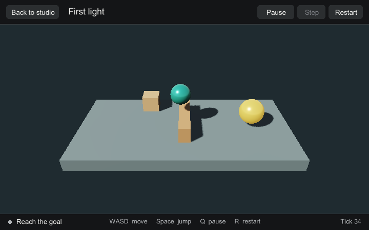

# Bygg och provspela en bana

Bygg med `dunder build -o build/storm` från reporoten. MCP-klienten startar binären med `--mcp` och håller anslutningen öppen under arbetet. [Projektkonfiguration](../.mcp.json)

Om klientens arbetskatalog ligger utanför Storm, ange den absoluta sökvägen till binären i klientens serverkonfiguration. Relativa scenfiler läses och skrivs i serverns arbetskatalog. Varje anslutning har en egen spelvärld i minnet. [MCP:s stdio-transport](https://modelcontextprotocol.io/specification/2025-11-25/basic/transports)

För att följa agentens bygge i ett öppet fönster, spara en första bana och kör `./build/storm --scene bana.storm.json --watch`. Storm läser ändringar inom en halv sekund. Ett lyckat byte startar den redigerade nivån vid tick noll. Om en ofullständig fil dyker upp visar fönstret ett fel och låter den tidigare nivån fortsätta.

## Spela till mål med verktygen

| Verktyg | Argument | Förväntat resultat |
| --- | --- | --- |
| `storm_new` | `{"template":"demo"}` | *First light* vid tick 0 |
| `storm_step` | `{"x":1,"ticks":20}` | Spelaren har fått markkontakt och närmar sig hindret |
| `storm_step` | `{"x":1,"jump":true,"ticks":1}` | Spelaren hoppar |
| `storm_step` | `{"x":1,"ticks":52}` | `tick` är 73 och `won` är `true` |
| `storm_preview` | `{}` | En PNG av det aktuella läget |
| `storm_save` | `{"path":"bana.storm.json"}` | Banans startläge sparas på disk |



Starta den sparade banan med `./build/storm --scene bana.storm.json`. En ny agent kan öppna den med `storm_load`. `storm_reset` återställer spelaren och alla kroppar till banans startläge. `storm_inspect` ger position, hastighet, markkontakt och antal kontaktpar. Med `{"view":"scene"}` får agenten den redigerbara banan.

## Skapa en egen bana

Använd `storm_set_scene` med hela nivån i argumentet `scene`, eller bygg vidare ett objekt i taget med `storm_upsert` och `storm_remove`. Ett objektnamn är dess identitet. En lyckad ändring startar en ny provspelning vid tick 0. En ogiltig ändring bevarar både bana och pågående provspelning.

```json
{
  "version": 1,
  "name": "Spring till fyren",
  "gravity": [0, -9.81, 0],
  "entities": [
    {"name":"Golv","shape":"box","position":[0,-0.25,0],"size":[8,0.5,4]},
    {"name":"Spelare","shape":"sphere","role":"player","mass":1,"position":[-2,0.5,0],"color":[0.04,0.5,0.42]},
    {"name":"Fyr","shape":"sphere","role":"goal","position":[2,0.5,0],"color":[1,0.62,0.12]}
  ]
}
```

Position och storlek anges i meter. Storleken är hela lådans mått eller sfärens diameter på alla tre axlar. Positiv massa ger en dynamisk kropp. Massan noll ger en statisk kropp. En spelare har positiv massa och ett mål är en statisk sensor. Materialparametrarna `friction` och `restitution` ligger mellan 0 och 1. Spelriktningen följer världsaxlarna X och Z, med Y uppåt.

Fysiken hanterar förflyttning hos sfärer och axelriktade lådor. Solvern använder upp till 16 delsteg för snabba kroppar. Rotationsdynamik, leder och kontinuerlig kollisionsdetektion ingår inte i version 1. En bana rymmer 128 objekt och ett verktygsanrop kan köra 600 tick. I fönstret kan upp till åtta tick hämtas in efter en fördröjd bildruta.
