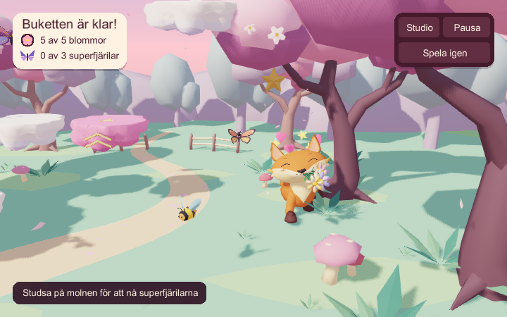

# Bygg och provspela en bana

Bygg med `dunder build -o build/storm` från reporoten. MCP-klienten startar binären med `--mcp` och håller anslutningen öppen under arbetet. [Projektkonfiguration](../.mcp.json)

Om klientens arbetskatalog ligger utanför Storm, ange den absoluta sökvägen till binären i klientens serverkonfiguration. Relativa scenfiler läses och skrivs i serverns arbetskatalog. Varje anslutning har en egen spelvärld i minnet. [MCP:s stdio-transport](https://modelcontextprotocol.io/specification/2025-11-25/basic/transports)

För att följa agentens bygge i ett öppet fönster, spara en första bana och kör `./build/storm --scene bana.storm.json --watch`. Storm läser ändringar inom en halv sekund. Ett lyckat byte startar den redigerade nivån vid tick noll. Om en ofullständig fil dyker upp visar fönstret ett fel och låter den tidigare nivån fortsätta.

## Utforska Blomsterskogen

Blomsterskogen sträcker sig över 27 × 23 meter (`[-13.5, -11.5, 13.5, 11.5]`) med flera sammanlänkade zoner att utforska, tio vildblommor att samla till buketten och fem lysande bonusfjärilar högt uppe i trädkronorna.

- **Körsbärsgläntan** `(0, 2)`: startgläntan med aprikosfärgade stigar som förgrenar sig åt väster, norr, öster och söder.
- **Picknickgläntan** `(-8.4, 5.2)` och **Svampdungen** `(-9.2, -2.8)` i väster: ett mjukt lapptäcke med kuddar och korg i sydväst och en förtrollad dunge med prickiga flugsvampar i väster.
- **Bäckbron** `(0, -4.8)` och **Lyktängen** `(0, -8.8)` i norr: en låg träbro med helt gångbar brobana över bäcken ut mot en lyktbelyst äng i norr.
- **Bärgläntan** `(8.8, -1.8)`, **Solkullen** `(8.6, 4.6)` och **Södra Klöverängen** `(0, 8.0)` i öster och söder: soliga bärbuskar, en mossig ihålig stubbe och en klöveräng som binder ihop väster och öster.
- **Höga Kronan** (16 fluffiga moln varav 4 rosa studsmoln): två fullständiga luftvägar — **Västra molntrappan** (lugna stegmoln hela vägen utan studs) och **Östra studsleden** (snabba, studsiga jordgubbsmoln) — sammanbundna i mitten av genvägen **Bäckmolnet → Molnbron**. Båda leder till **Kronbalkongen** och därifrån vidare via **Stjärnstudsen** upp till den hemliga utsiktsplatsen **Stjärngläntan**.

I Blomsterskogen vinner Vallmo när alla tio vildblommor är plockade — åtta utspridda över markzonerna och två på lättillgängliga låga molnhyllor (**Svampmolnet** i väster och **Honungsmolnet** i öster). De fem bonusfjärilarna (**Guldvinge**, **Sidenvinge**, **Solvinge**, **Kronvinge** och **Stjärnvinge**) kan samlas både före och efter vinsten.

I spelfönstret kan du spela både med tangentbord och mus:

- **Gå och nosa:** Styr med **WASD** eller **piltangenterna**, eller **vänsterklicka** (och håll inne) på marken eller ett moln för att låta Vallmo tassa dit. Håll **Shift** för att strosa lugnt, eller **Shift + klicka** nära en blomma för att gå fram och nosa på den utan att plocka den.
- **Hoppa:** Tryck **mellanslag** för att hoppa och håll riktningen tills du är över nästa moln. Molnen bär Vallmo vid landning ovanifrån, och de rosa studsmolnen (**Hallonstudsen**, **Smultronstudsen**, **Bäckmolnet** och **Stjärnstudsen**) ger automatiskt en högre studs.
- **Klappa, sitta och mysa:** Klicka på Vallmo för att klappa henne, tryck **C** (eller klicka **Sitt**) för att slå dig ner och efter en stund slumra till, och tryck **F** (eller klicka **Mys**) för ett glatt lekskutt.
- **Kamera:** Håll **höger musknapp** och dra för att vrida kameran, använd **skrollhjulet** för att zooma in och ut, och **mittenklicka** (eller klicka **Kamera**) för att återställa vyn.

## Plocka hela buketten med verktygen

Tabellen följer spelets test för alla tio blommor och visar en rutt som besöker varje markzon, korsar Bäckbron och tar båda de låga molnblommorna. [Speltesterna](../packages/storm-play/tests/suite.ddr)

| Mål | Verktyg och argument | Efter anropet |
| --- | --- | --- |
| Starta banan | `storm_new` `{"template":"demo"}` | Vallmo står i Körsbärsgläntan med 0 av 10 blommor |
| Smörblomma (Körsbärsgläntan) | `storm_step` `{"x":-1,"z":0.16,"ticks":29}` + `{"ticks":3}` | 1 blomma |
| Prästkrage (Picknickgläntan) | `storm_step` `{"x":-1,"z":0.58,"ticks":81}` | 2 blommor |
| Klöverblomma (Södra Klöverängen) | `storm_step` `{"x":1,"z":0.36,"ticks":99}` | 3 blommor |
| Gullviva (Solkullen) | `storm_step` `{"x":1,"z":-0.32,"ticks":123}` | 4 blommor |
| Linnea (Bärgläntan) | `storm_step` `{"x":0.12,"z":-1,"ticks":90}` | 5 blommor |
| Blåklocka (Körsbärsgläntan öst) | `storm_step` `{"x":-1,"z":0.35,"ticks":93}` | 6 blommor |
| Solmolnet → Honungsmolnet (Smultronblomma) | `storm_step` `{"x":0.71,"z":0.71,"jump":true,"ticks":15}`, `{"ticks":48}`, `{"x":1,"z":0.62,"jump":true,"ticks":33}`, `{"ticks":34}` | 7 blommor |
| Över Bäckbron till Förgätmigej (Lyktängen) | `storm_step` `{"x":-1,"z":-0.45,"ticks":78}`, `{"x":0.05,"z":-1,"ticks":128}` | 8 blommor |
| Skogsviol (Svampdungen) | `storm_step` `{"x":-1,"z":0.69,"ticks":154}` | 9 blommor |
| Daggmolnet → Körsbärsmolnet → Svampmolnet (Skogsstjärna) | `storm_step` `{"x":1,"z":0.48,"ticks":108}`, `{"x":-1,"jump":true,"ticks":24}`, `{"ticks":40}`, `{"x":-1,"z":-0.62,"jump":true,"ticks":31}`, `{"ticks":34}`, `{"x":-0.94,"z":-1,"jump":true,"ticks":31}`, `{"ticks":34}` | 10 blommor, `won` är `true` |
| Förhandsvisa & spara | `storm_preview` `{}` och `storm_save` `{"path":"bana.storm.json"}` | PNG av buketten och sparad banfil |



Starta den sparade banan med `./build/storm --scene bana.storm.json`. En ny agent kan öppna den med `storm_load`. `storm_reset` återställer spelaren och alla kroppar till banans startläge och sätter tillbaka blommorna och fjärilarna. `flowers` och `total_flowers` visar bukettens framsteg. `butterflies` och `total_butterflies` visar bonusen. På varje blomma och bonusfjäril visar `entities[].collected` om Vallmo har plockat den. `storm_inspect` ger position, hastighet, markkontakt och antal kontaktpar. Med `{"view":"scene"}` får agenten den redigerbara banan.

## Två luftvägar till Kronbalkongen och Stjärngläntan

Börja från `storm_new` med `{"template":"demo"}` eller kör `storm_reset` i demot, och låt två tick gå med `storm_step` `{"ticks":2}`. Varje rad nedan är två anrop till `storm_step`: först riktning i angivet antal tick (med `jump:true` vid avstampet från ett vanligt moln), sedan stilla tick `{"ticks":N}` tills landning eller studs.

### Alternativ 1: Västra molntrappan (lugn väg utan studs upp till Kronbalkongen)

| Sikta mot | Första anropet | Stilla tick |
| --- | --- | ---: |
| Daggmolnet | `{"x":-1,"z":-0.22,"jump":true,"ticks":43}` | 24 |
| Körsbärsmolnet | `{"x":-1,"z":-0.62,"jump":true,"ticks":31}` | 34 |
| Svampmolnet och Skogsstjärna | `{"x":-0.94,"z":-1,"jump":true,"ticks":31}` | 34 |
| Västra vilan och Guldvinge | `{"x":0.89,"z":-1,"jump":true,"ticks":32}` | 34 |
| Sidenmolnet och Sidenvinge | `{"x":1,"z":-0.54,"jump":true,"ticks":36}` | 30 |
| Kronbalkongen och Kronvinge | `{"x":1,"z":-0.41,"jump":true,"ticks":39}` | 28 |
| Stjärnstudsen (rosa studsmoln) | `{"x":0.8,"z":-1,"jump":true,"ticks":34}` | 38 |
| Stjärngläntan och Stjärnvinge (i studsen) | `{"x":-1,"z":-0.73,"ticks":36}` | 58 |

Vid tick 398 står Vallmo på Kronbalkongen med tre fjärilar helt utan studsmoln. Vid tick 470 studsar hon på Stjärnstudsen upp till Stjärngläntan (fjärde fjärilen), och kan därifrån glida tillbaka över Kronbalkongen och Smultronstudsen till Bärterassen och Östra utsikten för att hämta den femte fjärilen Solvinge.

### Alternativ 2: Östra studsleden (snabb studsled med genväg i mitten)

| Sikta mot | Första anropet | Stilla tick |
| --- | --- | ---: |
| Solmolnet | `{"x":1,"z":-0.15,"jump":true,"ticks":46}` | 20 |
| Honungsmolnet och Smultronblomma | `{"x":1,"z":0.62,"jump":true,"ticks":33}` | 34 |
| Hallonstudsen (rosa studsmoln) | `{"x":0.08,"z":-1,"jump":true,"ticks":32}` | 40 |
| Bärterassen (i studsen) | `{"x":0.04,"z":-1,"ticks":37}` | 54 |
| Östra utsikten och Solvinge | `{"x":1,"z":-0.48,"jump":true,"ticks":34}` | 34 |
| Tillbaka till Bärterassen | `{"x":-1,"z":0.48,"jump":true,"ticks":34}` | 48 |
| Smultronstudsen (rosa studsmoln) | `{"x":-1,"z":-0.68,"jump":true,"ticks":40}` | 33 |
| Kronbalkongen och Kronvinge (i studsen) | `{"x":-1,"z":-0.52,"ticks":49}` | 42 |

Från marken norr om startgläntan finns också mittgenvägen **Bäckmolnet → Molnbron**, där Vallmo kan svänga både västerut till **Sidenmolnet** och österut till **Smultronstudsen**. Testerna kör båda huvudrutterna med både enskilda fysiktick och varierande bildrutelängder och verifierar att alla fem fjärilar samlas med identiskt sluttillstånd. [Körbara rutter och kontroller](../packages/storm-play/tests/suite.ddr)

## Skapa en egen bana

Använd `storm_set_scene` med hela nivån i argumentet `scene`, eller bygg vidare ett objekt i taget med `storm_upsert` och `storm_remove`. Ett objektnamn är dess identitet. En lyckad ändring startar en ny provspelning vid tick 0. En ogiltig ändring bevarar både bana och pågående provspelning.

```json
{
  "version": 1,
  "name": "Spring till fyren",
  "gravity": [0, -9.81, 0],
  "entities": [
    {"name":"Golv","shape":"box","position":[0,-0.25,0],"size":[8,0.5,4]},
    {"name":"Spelare","shape":"sphere","role":"player","mass":1,"position":[-2,0.5,0],"color":[0.04,0.5,0.42]},
    {"name":"Fyr","shape":"sphere","role":"goal","position":[2,0.5,0],"color":[1,0.62,0.12]}
  ]
}
```

Position och storlek anges i meter. Storleken är hela lådans mått eller sfärens diameter på alla tre axlar. Positiv massa ger en dynamisk kropp. Massan noll ger en statisk kropp. En spelare har positiv massa och ett mål är en statisk sensor. Materialparametrarna `friction` och `restitution` ligger mellan 0 och 1. Spelriktningen följer världsaxlarna X och Z, med Y uppåt.

`"theme":"blossom"` ger spelaren rävmodellen och gör objekt med `"role":"flower"` till plockbara blommor. `"bounds":[minX,minZ,maxX,maxZ]` avgränsar spelarens rörelse. Blommor har massa noll. Med rollen `collider` går det att ge till exempel en trädstam eller ett broräcke en osynlig, fast kollisionskropp. En bana med enbart blommor vinns när alla är plockade. Finns även ett mål ska spelaren nå det efter blomplockningen.

En molnplattform har `"shape":"box"`, massa noll och rollen `cloud` eller `boost_cloud`. Den senare ger spelaren en automatisk studs vid landning. En bonusfjäril har rollen `super_butterfly` och är en statisk sensor. I en bana som enbart har bonusfjärilar som samlarobjekt och saknar mål vinner spelaren genom att samla alla fjärilar.

Fysiken hanterar förflyttning hos sfärer och axelriktade lådor. Solvern använder upp till 16 delsteg för snabba kroppar. Rotationsdynamik, leder och kontinuerlig kollisionsdetektion ingår inte i version 1. En bana rymmer 128 objekt och ett verktygsanrop kan köra 600 tick. I fönstret kan upp till åtta tick hämtas in efter en fördröjd bildruta.
